# DBMS Practical – Experiment 4

## Joins, Subqueries, Set Operations, and EXPLAIN

---

## 1. Aim

To write and execute SQL queries using `INNER JOIN`, `LEFT JOIN`, self-join, three-way join, correlated subqueries, `EXISTS`, simulated `INTERSECT` and `EXCEPT`, and to compare query execution plans using `EXPLAIN`.

---

## 2. Prerequisite

This experiment uses the Employee–Department–Project schema from Experiment 3.

Before running these queries, make sure the following tables and data already exist:

- `employee`
- `department`
- `project`
- `employee_project`

Run the Experiment 3 SQL script first if the tables do not exist. In ByteXL, do not use `CREATE DATABASE` or `USE` if database access is restricted.

---

## 3. SQL Concepts Demonstrated

- INNER JOIN
- LEFT JOIN
- Self-join
- Three-way JOIN
- Correlated subquery
- EXISTS
- Simulated INTERSECT
- Simulated EXCEPT
- EXPLAIN execution plans
- Query-plan comparison

---

## 4. INNER JOIN

### Description

`INNER JOIN` returns rows that have matching values in both joined tables.

### Query

```sql
SELECT e.emp_id, e.emp_name, e.job_title, d.dept_name
FROM employee e
INNER JOIN department d ON e.dept_id = d.dept_id
ORDER BY e.emp_id;
```

### Purpose

This query displays each employee with the matching department name.

### Output

Paste the ByteXL output screenshot here.

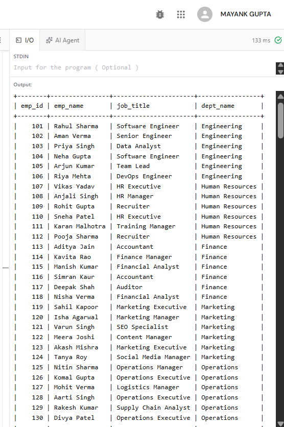

**Output Screenshot – INNER JOIN**

---

## 5. LEFT JOIN

### Description

`LEFT JOIN` returns every row from the left table and matching rows from the right table. If there is no match, the right-table columns contain `NULL`.

### Query

```sql
SELECT d.dept_id, d.dept_name, e.emp_id, e.emp_name
FROM department d
LEFT JOIN employee e ON d.dept_id = e.dept_id
ORDER BY d.dept_id, e.emp_id;
```

### Purpose

This query displays all departments, including departments that do not have any employees.

### Output

Paste the ByteXL output screenshot here.

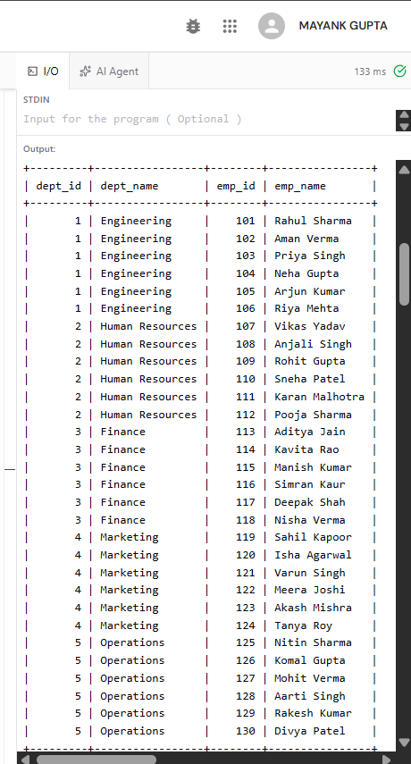

**Output Screenshot – LEFT JOIN**

---

## 6. Self-Join

### Description

A self-join joins a table with itself using aliases to compare rows from the same table.

### Query

```sql
SELECT e1.emp_name AS employee_1, e2.emp_name AS employee_2, e1.dept_id
FROM employee e1
INNER JOIN employee e2
  ON e1.dept_id = e2.dept_id
 AND e1.emp_id < e2.emp_id
ORDER BY e1.dept_id, e1.emp_id, e2.emp_id;
```

### Purpose

This query finds pairs of employees who belong to the same department. The condition `e1.emp_id < e2.emp_id` avoids duplicate pairs and prevents an employee from being paired with themselves.

### Output

Paste the ByteXL output screenshot here.

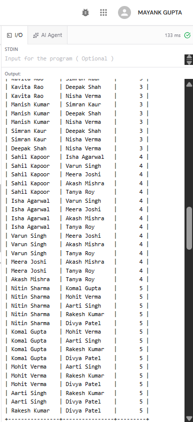

**Output Screenshot – Self-Join**

---

## 7. Three-Way JOIN

### Description

A three-way join combines related data from three tables. This query joins employee, department, and project using their department relationship.

### Query

```sql
SELECT e.emp_name, d.dept_name, p.project_name
FROM employee e
INNER JOIN department d ON e.dept_id = d.dept_id
INNER JOIN project p ON d.dept_id = p.dept_id
ORDER BY e.emp_name, p.project_name;
```

### Purpose

This query combines employee, department, and project information. It lists projects associated with each employee's department; it does not represent individual employee-project assignments.

### Output

Paste the ByteXL output screenshot here.

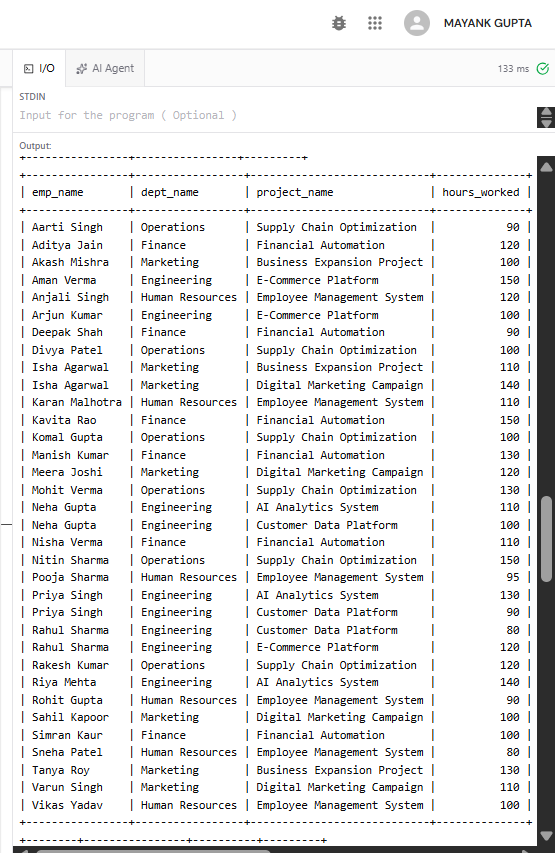

**Output Screenshot – Three-Way JOIN**

---

## 8. Correlated Subquery

### Description

A correlated subquery refers to a column from the outer query. Its result depends on the current row being considered by the outer query.

### Query

```sql
SELECT e.emp_id, e.emp_name, e.salary, e.dept_id
FROM employee e
WHERE e.salary > (
    SELECT AVG(e2.salary)
    FROM employee e2
    WHERE e2.dept_id = e.dept_id
)
ORDER BY e.dept_id, e.salary DESC;
```

### Purpose

This query displays employees whose salary is greater than the average salary of their own department.

### Output

Paste the ByteXL output screenshot here.

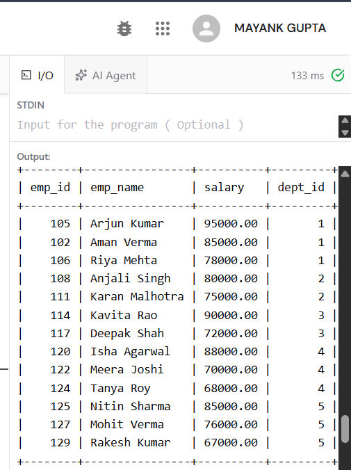

**Output Screenshot – Correlated Subquery**

---

## 9. EXISTS

### Description

`EXISTS` tests whether a subquery returns at least one row.

### Query

```sql
SELECT e.emp_id, e.emp_name
FROM employee e
WHERE EXISTS (
    SELECT 1 FROM employee_project ep WHERE ep.emp_id = e.emp_id
)
ORDER BY e.emp_id;
```

### Purpose

This query displays employees who are assigned to at least one project.

### Output

Paste the ByteXL output screenshot here.

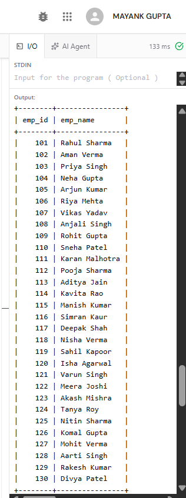

**Output Screenshot – EXISTS**

---

## 10. Simulated INTERSECT

### Description

`INTERSECT` returns rows common to two query results. When a database version does not support `INTERSECT`, `EXISTS` can simulate the same set-membership logic.

### Query

```sql
SELECT e.emp_id, e.emp_name
FROM employee e
WHERE e.dept_id = 1
  AND EXISTS (
      SELECT 1 FROM employee_project ep WHERE ep.emp_id = e.emp_id
  )
ORDER BY e.emp_id;
```

### Purpose

This query returns employees who satisfy both conditions: they belong to Engineering (`dept_id = 1`) and are assigned to at least one project. It simulates the intersection of those two sets.

### Output

Paste the ByteXL output screenshot here.

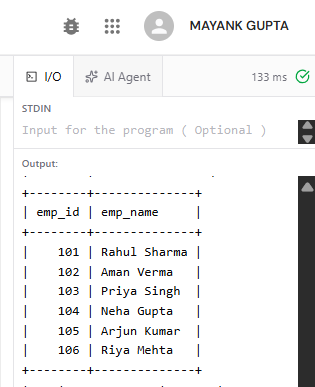

**Output Screenshot – Simulated INTERSECT**

---

## 11. Simulated EXCEPT

### Description

`EXCEPT` returns rows from the first query result that do not appear in the second query result. `NOT EXISTS` can simulate this operation.

### Query

```sql
SELECT e.emp_id, e.emp_name
FROM employee e
WHERE NOT EXISTS (
    SELECT 1 FROM employee_project ep WHERE ep.emp_id = e.emp_id
)
ORDER BY e.emp_id;
```

### Purpose

This query displays employees who are not assigned to any project. It simulates the set of employees minus the set of employees assigned to projects.

### Output

Paste the ByteXL output screenshot here.

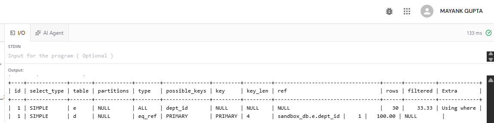

**Output Screenshot – Simulated EXCEPT**

---

## 12. EXPLAIN – JOIN Query

### Description

`EXPLAIN` shows the database optimizer's plan for executing a query. Exact output depends on the database engine, version, indexes, and data.

### Query

```sql
EXPLAIN
SELECT e.emp_name, d.dept_name
FROM employee e
INNER JOIN department d ON e.dept_id = d.dept_id
WHERE e.salary > 70000;
```

### Purpose

This query displays the execution plan for an employee-department join filtered by salary.

### Output

Paste the ByteXL EXPLAIN output screenshot here.

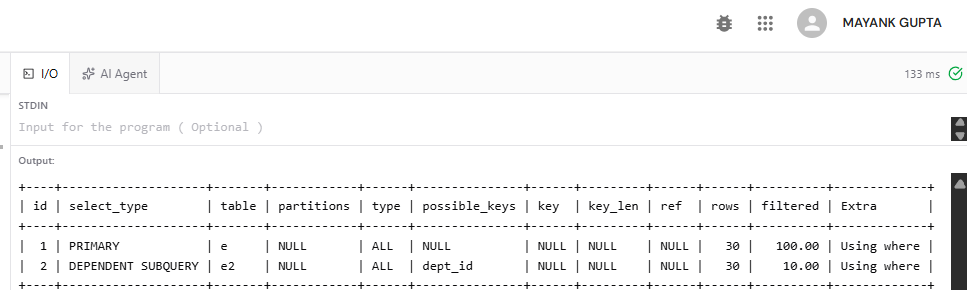

**Output Screenshot – EXPLAIN JOIN**

---

## 13. EXPLAIN – Correlated Subquery

### Query

```sql
EXPLAIN
SELECT e.emp_name, e.salary, e.dept_id
FROM employee e
WHERE e.salary > (
    SELECT AVG(e2.salary)
    FROM employee e2
    WHERE e2.dept_id = e.dept_id
);
```

### Purpose

This query displays the execution plan for the correlated subquery that compares each employee's salary with their department's average salary.

### Output

Paste the ByteXL EXPLAIN output screenshot here.

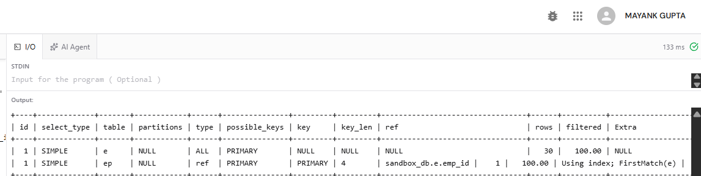

**Output Screenshot – EXPLAIN Correlated Subquery**

---

## 14. EXPLAIN – EXISTS Query

### Query

```sql
EXPLAIN
SELECT e.emp_id, e.emp_name
FROM employee e
WHERE EXISTS (
    SELECT 1 FROM employee_project ep WHERE ep.emp_id = e.emp_id
);
```

### Purpose

This query displays the execution plan for finding employees assigned to projects using `EXISTS`.

### Output

Paste the ByteXL EXPLAIN output screenshot here.

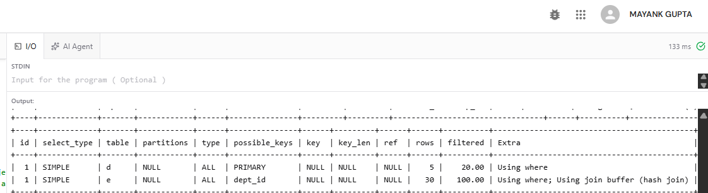

**Output Screenshot – EXPLAIN EXISTS**

---

## 15. Compare Execution Plans

### Query A – JOIN

```sql
EXPLAIN
SELECT e.emp_id, e.emp_name, d.dept_name
FROM employee e
INNER JOIN department d ON e.dept_id = d.dept_id
WHERE d.dept_name = 'Engineering';
```

### Query B – Subquery

```sql
EXPLAIN
SELECT e.emp_id, e.emp_name
FROM employee e
WHERE e.dept_id = (
    SELECT d.dept_id
    FROM department d
    WHERE d.dept_name = 'Engineering'
);
```

### Purpose

These queries retrieve employees in Engineering using different query structures. Run each `EXPLAIN` separately and compare the plan output.

Review fields such as:

- `type` – access method selected by the optimizer
- `possible_keys` – indexes the optimizer could consider
- `key` – index actually selected, if any
- `rows` – estimated number of rows examined
- `Extra` – additional execution information

The optimizer may produce similar plans for both queries. Do not assume one is faster without checking the actual output.

### Output

Paste the ByteXL EXPLAIN output screenshots here.

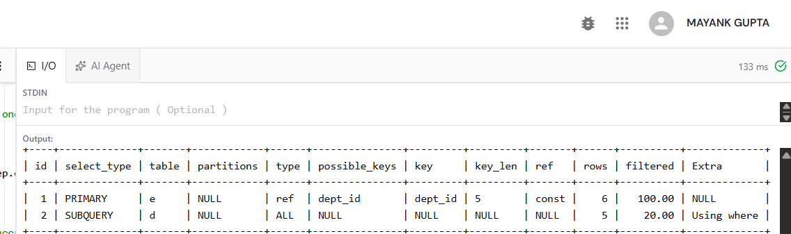

**Output Screenshot – Execution Plan Comparison**

---

## 16. Verification


#### Query

```sql
SELECT COUNT(*) AS total_employees FROM employee;
SELECT COUNT(*) AS total_departments FROM department;
SELECT COUNT(*) AS total_projects FROM project;
SELECT COUNT(*) AS total_employee_project_assignments FROM employee_project;

```

#### Output

Paste the ByteXL output screenshot here.

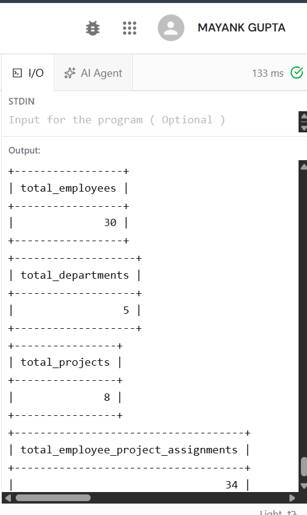

**Output Screenshot – Verification**

---

## 17. Result

SQL queries using `INNER JOIN`, `LEFT JOIN`, self-join, multi-table joins, correlated subqueries, `EXISTS`, simulated `INTERSECT` and `EXCEPT`, and `EXPLAIN` were prepared for the Employee–Department–Project schema.

---

## 18. Conclusion

This experiment demonstrates how joins combine related data, subqueries answer nested questions, `EXISTS` and `NOT EXISTS` test membership, and set-operation logic can be simulated in MySQL. `EXPLAIN` provides an execution plan that can be inspected to compare how the database optimizer approaches different queries.

---

## Folder Structure

```text
EXPERIMENT 04/
├── README.md
├── exp4.sql
└── images/
    ├── inner_join.png
    ├── left_join.png
    ├── self_join.png
    ├── three_way_join.png
    ├── correlated_subquery.png
    ├── exists.png
    ├── simulated_intersect.png
    ├── simulated_except.png
    ├── explain_join.png
    ├── explain_correlated_subquery.png
    ├── explain_exists.png
    ├── explain_comparison.png
    ├── verify_employees.png
    ├── verify_departments.png
    └── verify_projects.png
```

---

## Technologies Used

- MySQL
- SQL
- ByteXL SQL Workspace
- Visual Studio Code
- GitHub

**Experiment 4 – SQL Joins, Subqueries, Set Operations, and Execution Plans**
