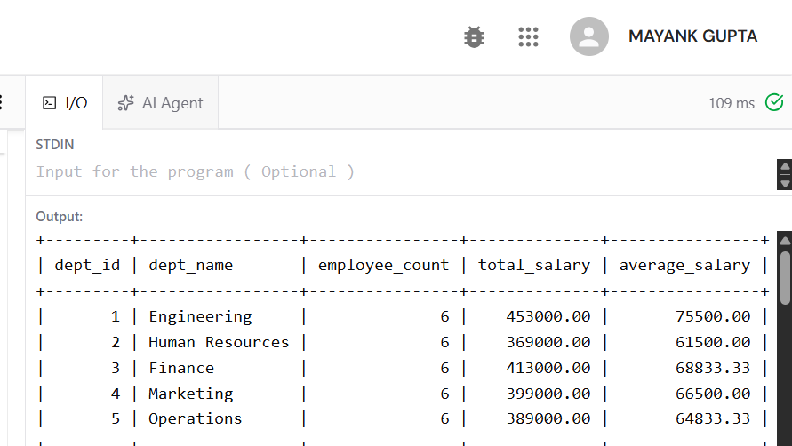
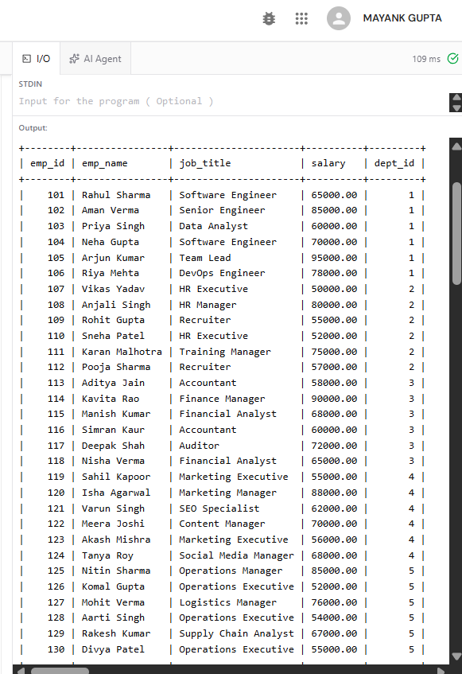
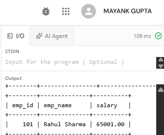
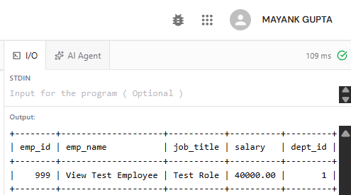
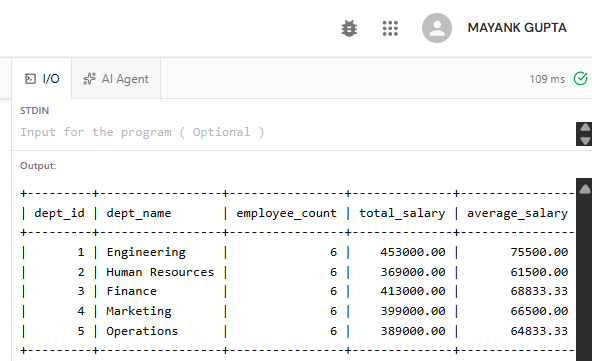
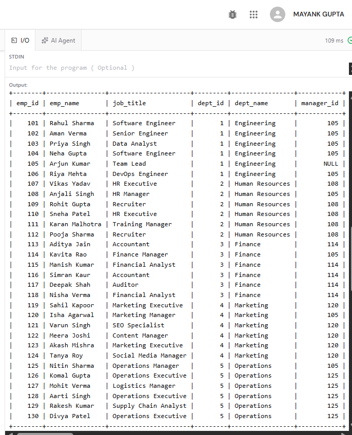
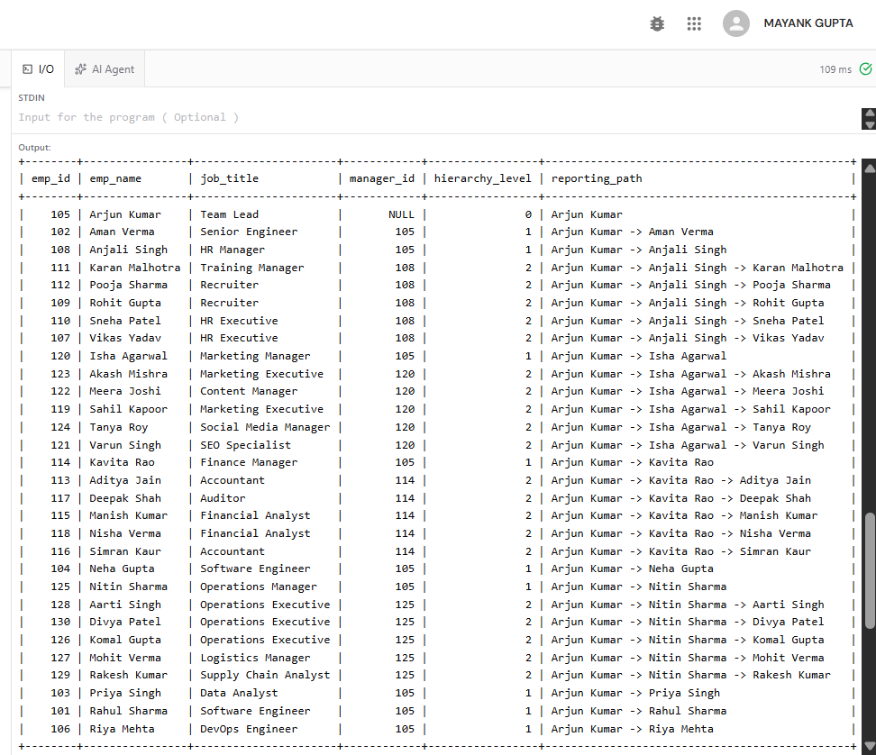
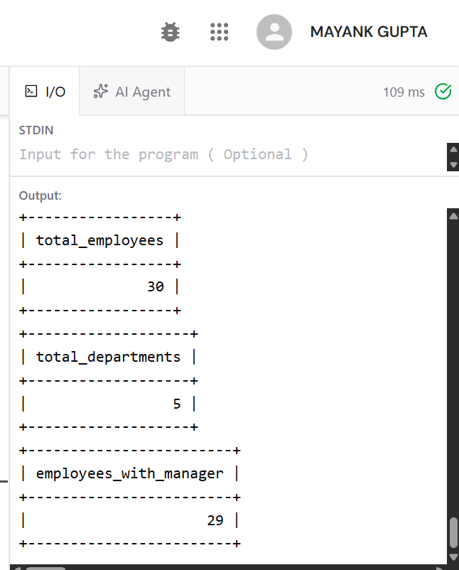

# DBMS Practical – Experiment 5

## SQL Views, View Updatability, and Recursive CTE

---

## 1. Aim

To create SQL views for department salary summary and employee hierarchy, test the updatability of views, and implement a recursive CTE to display employee reporting chains.

---

## 2. Prerequisite

This experiment uses the Employee–Department schema. The SQL file creates the `department` and `employee` tables and inserts sample data if the tables are not already present.

**Note:** The recursive CTE requires MySQL 8.0 or later. Run the SQL statements in order. The `manager_id` column is included in the employee table for the reporting hierarchy.

---

## 3. SQL Concepts Demonstrated

- Department salary summary view
- Simple employee view
- Testing view updatability with UPDATE and INSERT
- Aggregate view updatability limitations
- Employee hierarchy view
- Manager-reporting relationships
- Recursive CTE for reporting chains
- Inspecting view definitions
- Verification queries

---

## 4. Department Salary Summary View

### Description

A view is a virtual table defined by a query. This view summarizes the employee count, total salary, and average salary for each department.

### Query

```sql
CREATE VIEW department_salary_summary AS
SELECT d.dept_id, d.dept_name,
       COUNT(e.emp_id) AS employee_count,
       COALESCE(SUM(e.salary), 0) AS total_salary,
       ROUND(AVG(e.salary), 2) AS average_salary
FROM department d
LEFT JOIN employee e ON d.dept_id = e.dept_id
GROUP BY d.dept_id, d.dept_name;
```

### Purpose

Displays department-wise employee counts and salary statistics.

### Display Query

```sql
SELECT * FROM department_salary_summary ORDER BY dept_id;
```

### Output



**Output Screenshot – Department Salary Summary**

---

## 5. Simple Employee View

### Description

A simple view selects columns from one base table without grouping or aggregate functions. Such views are generally updatable when other conditions are met.

### Query

```sql
CREATE VIEW employee_basic_view AS
SELECT emp_id, emp_name, job_title, salary, dept_id
FROM employee;
```

### Purpose

Provides a simplified way to access employee information.

### Display Query

```sql
SELECT * FROM employee_basic_view ORDER BY emp_id;
```

### Output



**Output Screenshot – Employee Basic View**

---

## 6. Test UPDATE Through a View

### Description

An update through a simple view can update the underlying table. This test uses a transaction and rolls it back to preserve the original sample data.

### Query

```sql
START TRANSACTION;
UPDATE employee_basic_view
SET salary = salary + 1
WHERE emp_id = 101;

SELECT emp_id, emp_name, salary
FROM employee
WHERE emp_id = 101;
ROLLBACK;
```

### Purpose

Tests whether an update through the simple view changes the base table. `ROLLBACK` restores the original salary.

### Output



**Output Screenshot – View UPDATE Test**

---

## 7. Test INSERT Through a View

### Description

A simple view may allow inserts if the values satisfy base-table constraints and all required columns are supplied.

### Query

```sql
START TRANSACTION;
INSERT INTO employee_basic_view (emp_id, emp_name, job_title, salary, dept_id)
VALUES (999, 'View Test Employee', 'Test Role', 40000, 1);

SELECT * FROM employee_basic_view WHERE emp_id = 999;
ROLLBACK;
```

### Purpose

Tests inserting through the simple view. The test row is removed by `ROLLBACK`.

### Output



**Output Screenshot – View INSERT Test**

---

## 8. Updatability of Aggregate Views

### Description

Views using aggregate functions and `GROUP BY` are generally not updatable because their rows summarize multiple base-table rows.

### Query

```sql
SELECT * FROM department_salary_summary;
```

### Purpose

Displays the aggregate view. An update to this view is expected to be rejected by MySQL. If your instructor requests an error demonstration, run this separately:

```sql
-- UPDATE department_salary_summary
-- SET average_salary = 70000
-- WHERE dept_id = 1;
```

### Output



**Output Screenshot – Aggregate View**

---

## 9. Employee Hierarchy View

### Description

This view combines employee information with department names and the manager ID.

### Query

```sql
CREATE VIEW employee_hierarchy AS
SELECT e.emp_id, e.emp_name, e.job_title, e.dept_id, d.dept_name, e.manager_id
FROM employee e
LEFT JOIN department d ON e.dept_id = d.dept_id;
```

### Purpose

Displays employees alongside their departments and manager IDs.

### Display Query

```sql
SELECT * FROM employee_hierarchy ORDER BY dept_id, emp_id;
```

### Output



**Output Screenshot – Employee Hierarchy View**

---

## 10. Add Manager Relationship

### Description

`manager_id` stores the employee ID of an employee's manager and references `emp_id` in the same table.

### Query

In this experiment, the `manager_id` column is included when the employee table is created:

```sql
manager_id INT NULL,
FOREIGN KEY (manager_id) REFERENCES employee(emp_id)
```

### Purpose

Creates a self-referencing manager relationship so employees can report to other employees.

### Output



---

## 11. Set Up Sample Reporting Relationships

### Description

These updates assign sample managers to employees so the recursive CTE can demonstrate reporting chains.

### Query

```sql
UPDATE employee SET manager_id = NULL;
UPDATE employee SET manager_id = 105 WHERE emp_id IN (101, 102, 103, 104, 106);
UPDATE employee SET manager_id = 108 WHERE emp_id IN (107, 109, 110, 111, 112);
UPDATE employee SET manager_id = 114 WHERE emp_id IN (113, 115, 116, 117, 118);
UPDATE employee SET manager_id = 120 WHERE emp_id IN (119, 121, 122, 123, 124);
UPDATE employee SET manager_id = 125 WHERE emp_id IN (126, 127, 128, 129, 130);
UPDATE employee SET manager_id = 105 WHERE emp_id IN (108, 114, 120, 125);
```

### Purpose

Creates illustrative reporting relationships. Employee 105 is the top-level manager in this sample.

### Output

The following table shows the reporting relationships set by these statements:

| Employee ID | Employee | Manager ID |
|---:|---|---:|
| 101 | Rahul Sharma | 105 |
| 102 | Aman Verma | 105 |
| 103 | Priya Singh | 105 |
| 104 | Neha Gupta | 105 |
| 105 | Arjun Kumar | `NULL` |
| 106 | Riya Mehta | 105 |
| 107 | Vikas Yadav | 108 |
| 108 | Anjali Singh | 105 |
| 109 | Rohit Gupta | 108 |
| 110 | Sneha Patel | 108 |
| 111 | Karan Malhotra | 108 |
| 112 | Pooja Sharma | 108 |
| 113 | Aditya Jain | 114 |
| 114 | Kavita Rao | 105 |
| 115 | Manish Kumar | 114 |
| 116 | Simran Kaur | 114 |
| 117 | Deepak Shah | 114 |
| 118 | Nisha Verma | 114 |
| 119 | Sahil Kapoor | 120 |
| 120 | Isha Agarwal | 105 |
| 121 | Varun Singh | 120 |
| 122 | Meera Joshi | 120 |
| 123 | Akash Mishra | 120 |
| 124 | Tanya Roy | 120 |
| 125 | Nitin Sharma | 105 |
| 126 | Komal Gupta | 125 |
| 127 | Mohit Verma | 125 |
| 128 | Aarti Singh | 125 |
| 129 | Rakesh Kumar | 125 |
| 130 | Divya Patel | 125 |

---

## 12. Recursive CTE – Reporting Chains

### Description

A recursive common table expression (CTE) repeatedly refers to its own result to traverse a hierarchy. This query starts with employees who have no manager and follows the manager-to-employee relationships.

### Query

```sql
WITH RECURSIVE reporting_chain AS (
    SELECT e.emp_id, e.emp_name, e.job_title, e.manager_id,
           0 AS hierarchy_level,
           CAST(e.emp_name AS CHAR(1000)) AS reporting_path
    FROM employee e
    WHERE e.manager_id IS NULL

    UNION ALL

    SELECT e.emp_id, e.emp_name, e.job_title, e.manager_id,
           rc.hierarchy_level + 1,
           CAST(CONCAT(rc.reporting_path, ' -> ', e.emp_name) AS CHAR(1000))
    FROM employee e
    INNER JOIN reporting_chain rc ON e.manager_id = rc.emp_id
)
SELECT emp_id, emp_name, job_title, manager_id, hierarchy_level, reporting_path
FROM reporting_chain
ORDER BY reporting_path;
```

### Purpose

Displays each employee's reporting level and a readable path from the top-level manager to the employee.

**Requirement:** MySQL 8.0 or later is required for recursive CTE support.

### Output

The following is the expected logical output for the sample reporting relationships above. Row order follows `reporting_path`.

| Employee ID | Employee | Job Title | Manager ID | Level | Reporting Path |
|---:|---|---|---:|---:|---|
| 105 | Arjun Kumar | Team Lead | `NULL` | 0 | Arjun Kumar |
| 101 | Rahul Sharma | Software Engineer | 105 | 1 | Arjun Kumar -> Rahul Sharma |
| 102 | Aman Verma | Senior Engineer | 105 | 1 | Arjun Kumar -> Aman Verma |
| 103 | Priya Singh | Data Analyst | 105 | 1 | Arjun Kumar -> Priya Singh |
| 104 | Neha Gupta | Software Engineer | 105 | 1 | Arjun Kumar -> Neha Gupta |
| 106 | Riya Mehta | DevOps Engineer | 105 | 1 | Arjun Kumar -> Riya Mehta |
| 108 | Anjali Singh | HR Manager | 105 | 1 | Arjun Kumar -> Anjali Singh |
| 107 | Vikas Yadav | HR Executive | 108 | 2 | Arjun Kumar -> Anjali Singh -> Vikas Yadav |
| 109 | Rohit Gupta | Recruiter | 108 | 2 | Arjun Kumar -> Anjali Singh -> Rohit Gupta |
| 110 | Sneha Patel | HR Executive | 108 | 2 | Arjun Kumar -> Anjali Singh -> Sneha Patel |
| 111 | Karan Malhotra | Training Manager | 108 | 2 | Arjun Kumar -> Anjali Singh -> Karan Malhotra |
| 112 | Pooja Sharma | Recruiter | 108 | 2 | Arjun Kumar -> Anjali Singh -> Pooja Sharma |
| 114 | Kavita Rao | Finance Manager | 105 | 1 | Arjun Kumar -> Kavita Rao |
| 113 | Aditya Jain | Accountant | 114 | 2 | Arjun Kumar -> Kavita Rao -> Aditya Jain |
| 115 | Manish Kumar | Financial Analyst | 114 | 2 | Arjun Kumar -> Kavita Rao -> Manish Kumar |
| 116 | Simran Kaur | Accountant | 114 | 2 | Arjun Kumar -> Kavita Rao -> Simran Kaur |
| 117 | Deepak Shah | Auditor | 114 | 2 | Arjun Kumar -> Kavita Rao -> Deepak Shah |
| 118 | Nisha Verma | Financial Analyst | 114 | 2 | Arjun Kumar -> Kavita Rao -> Nisha Verma |
| 120 | Isha Agarwal | Marketing Manager | 105 | 1 | Arjun Kumar -> Isha Agarwal |
| 119 | Sahil Kapoor | Marketing Executive | 120 | 2 | Arjun Kumar -> Isha Agarwal -> Sahil Kapoor |
| 121 | Varun Singh | SEO Specialist | 120 | 2 | Arjun Kumar -> Isha Agarwal -> Varun Singh |
| 122 | Meera Joshi | Content Manager | 120 | 2 | Arjun Kumar -> Isha Agarwal -> Meera Joshi |
| 123 | Akash Mishra | Marketing Executive | 120 | 2 | Arjun Kumar -> Isha Agarwal -> Akash Mishra |
| 124 | Tanya Roy | Social Media Manager | 120 | 2 | Arjun Kumar -> Isha Agarwal -> Tanya Roy |
| 125 | Nitin Sharma | Operations Manager | 105 | 1 | Arjun Kumar -> Nitin Sharma |
| 126 | Komal Gupta | Operations Executive | 125 | 2 | Arjun Kumar -> Nitin Sharma -> Komal Gupta |
| 127 | Mohit Verma | Logistics Manager | 125 | 2 | Arjun Kumar -> Nitin Sharma -> Mohit Verma |
| 128 | Aarti Singh | Operations Executive | 125 | 2 | Arjun Kumar -> Nitin Sharma -> Aarti Singh |
| 129 | Rakesh Kumar | Supply Chain Analyst | 125 | 2 | Arjun Kumar -> Nitin Sharma -> Rakesh Kumar |
| 130 | Divya Patel | Operations Executive | 125 | 2 | Arjun Kumar -> Nitin Sharma -> Divya Patel |

---

## 13. Inspect View Definitions

### Query

```sql
SHOW CREATE VIEW department_salary_summary;
SHOW CREATE VIEW employee_basic_view;
SHOW CREATE VIEW employee_hierarchy;
```

### Purpose

Displays the SQL definitions used to create the views.

### Output

The output contains the view name and its SQL definition. Exact formatting and metadata may vary by MySQL/ByteXL version.

#### `department_salary_summary`

```sql
CREATE VIEW department_salary_summary AS
SELECT d.dept_id, d.dept_name,
       COUNT(e.emp_id) AS employee_count,
       COALESCE(SUM(e.salary), 0) AS total_salary,
       ROUND(AVG(e.salary), 2) AS average_salary
FROM department d
LEFT JOIN employee e ON d.dept_id = e.dept_id
GROUP BY d.dept_id, d.dept_name;
```

#### `employee_basic_view`

```sql
CREATE VIEW employee_basic_view AS
SELECT emp_id, emp_name, job_title, salary, dept_id
FROM employee;
```

#### `employee_hierarchy`

```sql
CREATE VIEW employee_hierarchy AS
SELECT e.emp_id, e.emp_name, e.job_title, e.dept_id, d.dept_name, e.manager_id
FROM employee e
LEFT JOIN department d ON e.dept_id = d.dept_id;
```

---

## 14. Verification

### Queries

```sql
SELECT COUNT(*) AS total_employees FROM employee;
SELECT COUNT(*) AS total_departments FROM department;
SELECT COUNT(*) AS employees_with_manager
FROM employee
WHERE manager_id IS NOT NULL;
```

### Purpose

Verifies the employee count, department count, and number of employees assigned a manager.

### Output

The verification results are included in the screenshot below.



**Output Screenshot – Verification**

---

## 15. Result

Views for department salary summary and employee hierarchy were defined. The updatability of a simple view was tested, the limitations of aggregate views were reviewed, and a recursive CTE was written to display employee reporting chains.

---

## 16. Conclusion

This experiment demonstrates how SQL views simplify data access, how view structure affects updatability, and how recursive CTEs can traverse hierarchical relationships such as employee reporting chains.

---

## Folder Structure

```text
EXPERIMENT 05/
├── README.md
├── exp5.sql
└── images/
    ├── department_salary_summary.png
    ├── employee_basic_view.png
    ├── view_update_test.png
    ├── view_insert_test.png
    ├── aggregate_view.png
    ├── employee_hierarchy.png
    └── verification.png
```

---

## Technologies Used

- MySQL
- SQL Views
- Recursive CTE
- ByteXL SQL Workspace
- Visual Studio Code
- GitHub

**Experiment 5 – SQL Views, View Updatability, and Recursive CTE**
