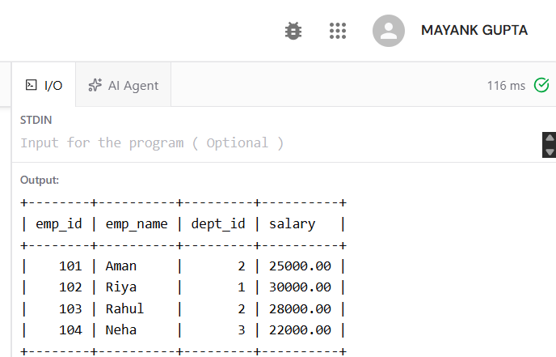
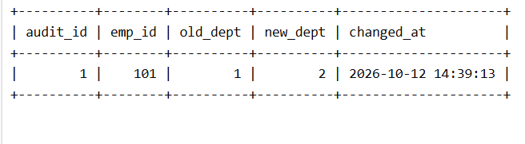

# Experiment 6: Stored Procedure and Triggers

## Aim
To transfer an employee between departments using a stored procedure, validate salaries with triggers, and log department changes in an audit table.

## Tables
- `department`: department ID and name
- `employee`: employee ID, name, department ID, and salary
- `employee_audit`: records employee department changes

The SQL script creates 3 departments and 4 employees. It is self-contained and does not rely on tables from another experiment.

## Stored Procedure
`transfer_employee(emp_id, new_dept_id)` checks that the IDs are provided, the employee exists, the target department exists, and the employee is not already in that department. It then updates the employee's department. SQL errors are rolled back and re-raised.

## Triggers
- `validate_salary_insert`: rejects a salary that is `NULL` or less than or equal to zero during insertion.
- `validate_salary_update`: rejects a salary that is `NULL` or less than or equal to zero during an update.
- `employee_audit_update`: logs a department change in `employee_audit`.

## How to Run
1. Run `exp6.sql` in a MySQL client that supports stored procedures, triggers, and `DELIMITER`.
2. The script calls `transfer_employee(101, 2)` to transfer Aman from department 1 to department 2.
3. Run the two `SELECT` queries at the end to view the employee records and audit log.
4. Optional error tests are commented out at the bottom of the SQL file. Uncomment and run one at a time.

**Note:** The script drops and recreates the three tables. Do not run it if you need to preserve data in tables with these names. Some browser-based SQL runners do not support stored procedures or triggers.

## Output Screenshots

### 1. Employee Table Output
This screenshot should show the rows returned by `SELECT * FROM employee;`.

### 2. Audit Log Output
This screenshot should show the rows returned by `SELECT * FROM employee_audit;`.

## Expected Result
After `CALL transfer_employee(101, 2);`, employee 101 (Aman) should have `dept_id = 2`. The audit table should show the department change from `old_dept = 1` to `new_dept = 2`.

## Result
The stored procedure transfers an employee after validation, salary triggers reject invalid salary values, and the audit trigger records department changes.
