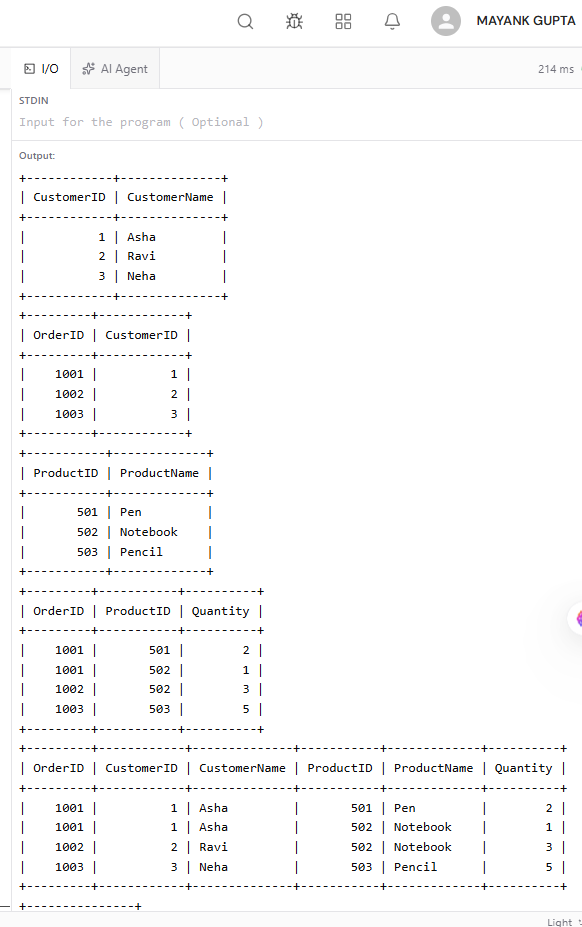
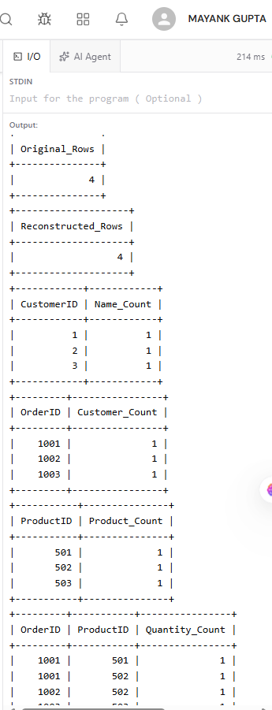

# DBMS Practical – Experiment 7

## Sales Table Normalization: UNF to 1NF, 2NF, 3NF, and BCNF

---

## 1. Aim

To normalize an unnormalized sales table containing order, customer, and product information into First Normal Form (1NF), Second Normal Form (2NF), Third Normal Form (3NF), and Boyce-Codd Normal Form (BCNF). The experiment also verifies lossless joins and functional dependency preservation.

---

## 2. Database and Source Data

The experiment is implemented in MySQL using the SQL script `exp7.sql`.

The original `Sales_UNF` table stores an order, customer details, and repeating product columns for each order:

- `Product1ID`, `Product1Name`, `Product1Qty`
- `Product2ID`, `Product2Name`, `Product2Qty`

The sample data contains three orders and four order-item rows after converting the repeating product columns into separate records.

---

## 3. Functional Dependencies

The following functional dependencies are used during normalization:

- `OrderID -> CustomerID`
- `CustomerID -> CustomerName`
- `ProductID -> ProductName`
- `(OrderID, ProductID) -> Quantity`

The composite key `(OrderID, ProductID)` identifies each order item.

---

## 4. Normalization Steps

### 4.1 First Normal Form (1NF)

The repeating product columns are removed and each product in an order is stored as one row. The table `Sales_1NF` contains atomic values and uses `(OrderID, ProductID)` as its composite primary key.

This structure eliminates multi-valued and repeating product columns.

### 4.2 Second Normal Form (2NF)

In 2NF, partial dependencies are removed from the composite-key table.

The data is divided into:

- `Sales_2NF_Order` — order and customer details
- `Sales_2NF_Product` — product information
- `Sales_2NF_OrderItem` — order-product quantity information

`CustomerName` is identified by `CustomerID`, and `ProductName` is identified by `ProductID`, so they are separated from the order-item table.

### 4.3 Third Normal Form (3NF)

The transitive dependency `OrderID -> CustomerID -> CustomerName` is removed.

The 3NF schema contains:

- `Sales_3NF_Customer`
- `Sales_3NF_Order`
- `Sales_3NF_Product`
- `Sales_3NF_OrderItem`

Here, customer names are stored only in the customer table, and the order table stores only `OrderID` and `CustomerID`.

### 4.4 Boyce-Codd Normal Form (BCNF)

BCNF copies of the 3NF tables are created for verification:

- `Sales_BCNF_Customer`
- `Sales_BCNF_Order`
- `Sales_BCNF_Product`
- `Sales_BCNF_OrderItem`

Under the stated functional dependencies, the 3NF decomposition is already in BCNF because every determinant is a candidate key.

---

## 5. Normalized Schema

### Customer

| Column | Key | Description |
|---|---|---|
| `CustomerID` | Primary Key | Unique customer identifier |
| `CustomerName` | | Customer name |

### Order

| Column | Key | Description |
|---|---|---|
| `OrderID` | Primary Key | Unique order identifier |
| `CustomerID` | Foreign Key | References `Sales_3NF_Customer` |

### Product

| Column | Key | Description |
|---|---|---|
| `ProductID` | Primary Key | Unique product identifier |
| `ProductName` | | Product name |

### Order Item

| Column | Key | Description |
|---|---|---|
| `OrderID` | Composite Primary Key, Foreign Key | References `Sales_3NF_Order` |
| `ProductID` | Composite Primary Key, Foreign Key | References `Sales_3NF_Product` |
| `Quantity` | | Quantity of the product |

---

## 6. SQL Verification Details

### Lossless Join Verification

The four 3NF tables are joined using their primary and foreign key relationships:

```sql
SELECT
    o.OrderID,
    c.CustomerID,
    c.CustomerName,
    p.ProductID,
    p.ProductName,
    i.Quantity
FROM Sales_3NF_Order o
JOIN Sales_3NF_Customer c
    ON o.CustomerID = c.CustomerID
JOIN Sales_3NF_OrderItem i
    ON o.OrderID = i.OrderID
JOIN Sales_3NF_Product p
    ON i.ProductID = p.ProductID
ORDER BY o.OrderID, p.ProductID;
```

The join reconstructs the original 1NF information without creating duplicate or spurious rows.

### Row Count Comparison

The original 1NF relation and the reconstructed 3NF join should contain the same number of rows:

```sql
SELECT COUNT(*) AS Original_Rows
FROM Sales_1NF;

SELECT COUNT(*) AS Reconstructed_Rows
FROM Sales_3NF_Order o
JOIN Sales_3NF_Customer c
    ON o.CustomerID = c.CustomerID
JOIN Sales_3NF_OrderItem i
    ON o.OrderID = i.OrderID
JOIN Sales_3NF_Product p
    ON i.ProductID = p.ProductID;
```

In this experiment, both counts should be `4`.

### Dependency Preservation

Each functional dependency is checked to ensure it is preserved in the normalized tables:

```sql
-- CustomerID -> CustomerName
SELECT CustomerID,
       COUNT(DISTINCT CustomerName) AS Name_Count
FROM Sales_3NF_Customer
GROUP BY CustomerID;

-- OrderID -> CustomerID
SELECT OrderID,
       COUNT(DISTINCT CustomerID) AS Customer_Count
FROM Sales_3NF_Order
GROUP BY OrderID;

-- ProductID -> ProductName
SELECT ProductID,
       COUNT(DISTINCT ProductName) AS Product_Count
FROM Sales_3NF_Product
GROUP BY ProductID;

-- (OrderID, ProductID) -> Quantity
SELECT OrderID, ProductID,
       COUNT(DISTINCT Quantity) AS Quantity_Count
FROM Sales_3NF_OrderItem
GROUP BY OrderID, ProductID;
```

Every result should contain a count of `1`, showing that no non-key determinant determines multiple values.

---

## 7. How to Run

1. Open MySQL or the available SQL execution environment.
2. Run `exp7.sql` from top to bottom.
3. The script removes old experiment 7 tables, creates the UNF and normalized tables, inserts sample data, and executes the verification queries.
4. Review the four `SELECT * FROM Sales_3NF_*` results for the normalized tables.
5. Review the lossless join, row-count comparison, and dependency-preservation queries.

**Note:** The script drops and recreates tables prefixed with `Sales_`. Do not run it if those table names contain data that must be preserved.

---

## 8. Output Screenshots

### 8.1 Normalized Tables



**Output Screenshot – Normalized Tables**

### 8.2 SQL Verification



**Output Screenshot – SQL Verification**

---

## 9. Result

The sales data was successfully normalized from UNF to 1NF, 2NF, 3NF, and BCNF. Repeating columns and partial or transitive dependencies were removed. The lossless join reconstructs the original 1NF rows, the original and reconstructed row counts are both `4`, and the functional-dependency checks preserve all dependencies.