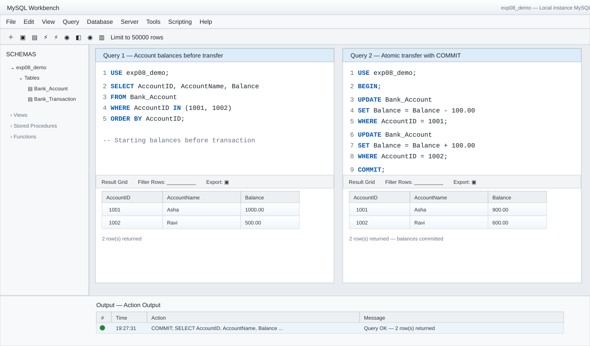
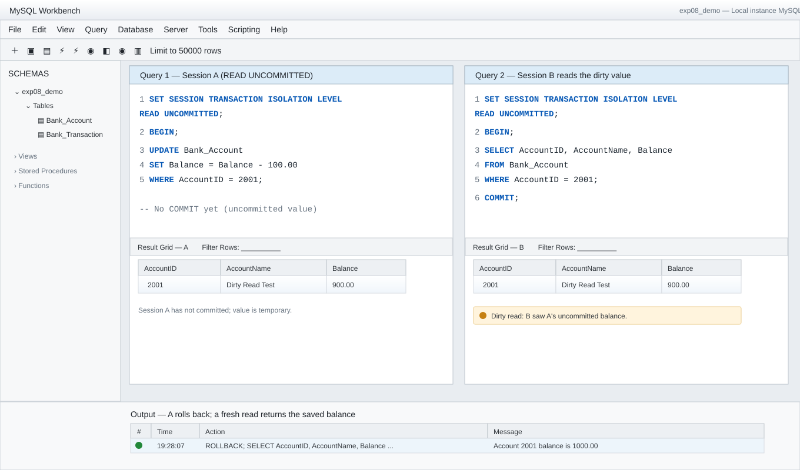

# DBMS Practical – Experiment 8

## Banking Transactions, Isolation Levels, and Concurrency Anomalies

---

## 1. Aim

To demonstrate banking-style transactions with `BEGIN`, `COMMIT`, `ROLLBACK`, and `SAVEPOINT`; simulate a failed transfer within a batch; and observe transaction isolation levels and concurrency anomalies using two MySQL sessions.

---

## 2. Database and Files

This experiment uses MySQL 8.0 and InnoDB tables.

- [`exp08.sql`](exp08.sql) creates the sample accounts and transaction ledger, then runs the commit, savepoint, and rollback examples.
- [`session_a.sql`](session_a.sql) contains the commands for the first concurrent session.
- [`session_b.sql`](session_b.sql) contains the commands for the second concurrent session.

The setup script drops and recreates only `Bank_Account` and `Bank_Transaction`. Do not run it if you need to preserve data in tables with those names.

---

## 3. Tables

### `Bank_Account`

Stores account IDs, names, and non-negative balances. The balance constraint prevents an account from being stored with a negative balance.

### `Bank_Transaction`

Stores completed transfers with source account, destination account, amount, and timestamp. Foreign keys ensure that both accounts exist.

---

## 4. Transaction Concepts Demonstrated

- **Atomic transfer:** debit and credit are grouped between `BEGIN` and `COMMIT`.
- **Full rollback:** cancel all changes in the active transaction.
- **Savepoint:** undo only a failed transfer item while keeping earlier successful work in the transaction.
- **Partial failure:** a transfer to missing account `9999` updates zero rows. The example checks the affected-row count and rolls back to the savepoint.
- **Insufficient funds:** a guarded debit affects zero rows; the complete transaction is rolled back.

### Expected Transaction Results

The initial balances are Asha (`1001`) = `1000.00` and Ravi (`1002`) = `500.00`.

1. The committed transfer of `100.00` changes the balances to `900.00` and `600.00`.
2. The batch transfer of `50.00` commits, while the optional transfer to missing account `9999` is undone. Balances become `850.00` and `650.00`; the ledger has two completed transfers.
3. The insufficient-funds debit affects zero rows. `ROLLBACK` leaves Asha's balance at `850.00`.



**Generated Workbench-style illustration – committed transfer**

---

## 5. Two-Session Isolation Demonstrations

Open two connections to the same MySQL schema, for example two query tabs in MySQL Workbench or two terminal clients. Run the marked commands in `session_a.sql` and `session_b.sql` in the exact order below. Do not execute an entire session file at once: pause at each `WAIT` marker and switch to the other connection.

Each session uses its own transaction. `SET SESSION TRANSACTION ISOLATION LEVEL ...` must be run before `BEGIN`.

### 5.1 Dirty Read at `READ UNCOMMITTED`

1. Session A: run **Dirty read – A1**, then pause.
2. Session B: run **Dirty read – B1**. It should read `900.00`, an uncommitted balance.
3. Session A: run **Dirty read – A2** to roll back.
4. Session B: query account `2001` again. It is back to `1000.00`; the earlier value was a dirty read.

### 5.2 Nonrepeatable Read at `READ COMMITTED`

1. Session A: run **Nonrepeatable read – A1** and note `500.00`.
2. Session B: run **Nonrepeatable read – B1** to add `50.00` and commit.
3. Session A: run **Nonrepeatable read – A2**. The same row now reads `550.00` in the same transaction.

### 5.3 Phantom Read at `READ COMMITTED`

1. Session A: run **Phantom read – A1**. The range query returns one row.
2. Session B: run **Phantom read – B1** to insert and commit account `2092`.
3. Session A: run **Phantom read – A2**. The same range query now returns two rows.

### 5.4 Lost Update

1. Session A: run **Lost update – A1** and read `250.00`. Note the application-calculated value `225.00`.
2. Session B: run **Lost update – B1** and read the same `250.00`. Note its application-calculated value `200.00`.
3. Session A: run **Lost update – A2** and commit `225.00`.
4. Session B: run **Lost update – B2** and commit its stale calculation, `200.00`.

The final balance is `200.00`; the first withdrawal of `25.00` was overwritten. Starting from `250.00`, both withdrawals should have resulted in `175.00`.



**Generated Workbench-style illustration – two-session dirty read**

### 5.5 Phantom Contrast at `REPEATABLE READ`

After both sessions finish the `READ COMMITTED` phantom test, remove its inserted row while neither session has an active transaction:

```sql
DELETE FROM Bank_Account WHERE AccountID IN (2092, 2098);
```

Then follow the **Repeatable-read phantom** steps in the session files. Session A's second range query remains at one row because InnoDB uses the transaction's consistent-read snapshot. Delete account `2092` again after the contrast before repeating it.

### 5.6 Range-Read Locking at `SERIALIZABLE`

1. Make sure accounts `2092` and `2098` are absent and both sessions have no active transaction.
2. Session A: run **Serializable range read – A1** and pause.
3. Session B: run **Serializable range read – B1**. Its insert of account `2098` should wait for Session A's range-read lock.
4. Session A: run **Serializable range read – A2** to commit. Session B's insert should then finish.
5. After Session B commits, remove account `2098` before repeating the test.

---

## 6. Isolation Levels

Set the isolation level before starting a transaction:

```sql
SET SESSION TRANSACTION ISOLATION LEVEL READ UNCOMMITTED;
SET SESSION TRANSACTION ISOLATION LEVEL READ COMMITTED;
SET SESSION TRANSACTION ISOLATION LEVEL REPEATABLE READ;
SET SESSION TRANSACTION ISOLATION LEVEL SERIALIZABLE;
```

- **READ UNCOMMITTED:** can expose another transaction's uncommitted changes (dirty reads).
- **READ COMMITTED:** each consistent read sees committed data as of that statement; repeated reads and range counts may change during the transaction.
- **REPEATABLE READ:** MySQL InnoDB's default; consistent reads within a transaction use a stable snapshot, preventing the nonrepeatable and phantom results shown under `READ COMMITTED`.
- **SERIALIZABLE:** provides the strongest isolation by making transactions behave serially; reads can acquire locks and block conflicting writes.

The two-session scripts demonstrate all four levels, show an application-level lost update, and compare `READ COMMITTED` with InnoDB's `REPEATABLE READ` snapshot behavior.

---

## 7. How to Run

1. In a MySQL 8.0 client, select the schema for this practical.
2. Run [`exp08.sql`](exp08.sql) once to create the tables and run the transaction examples.
3. Open two connections to that same schema.
4. Follow the step order in section 5, using the labeled commands in `session_a.sql` and `session_b.sql`.
5. Complete or roll back each transaction before starting another scenario. For repeat runs, use the setup script again only after both sessions have no active transaction.

**Important:** The two session files intentionally contain pauses. Their purpose is to interleave commands from separate connections; running either file from top to bottom cannot reproduce concurrency.

---

## 8. Result

The experiment demonstrates committed transfers, full and savepoint rollbacks, an application-detected partial failure, and read anomalies observed by interleaving two MySQL sessions. It also compares `READ UNCOMMITTED`, `READ COMMITTED`, and InnoDB `REPEATABLE READ` behavior.
