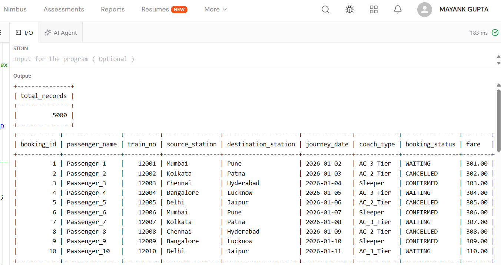
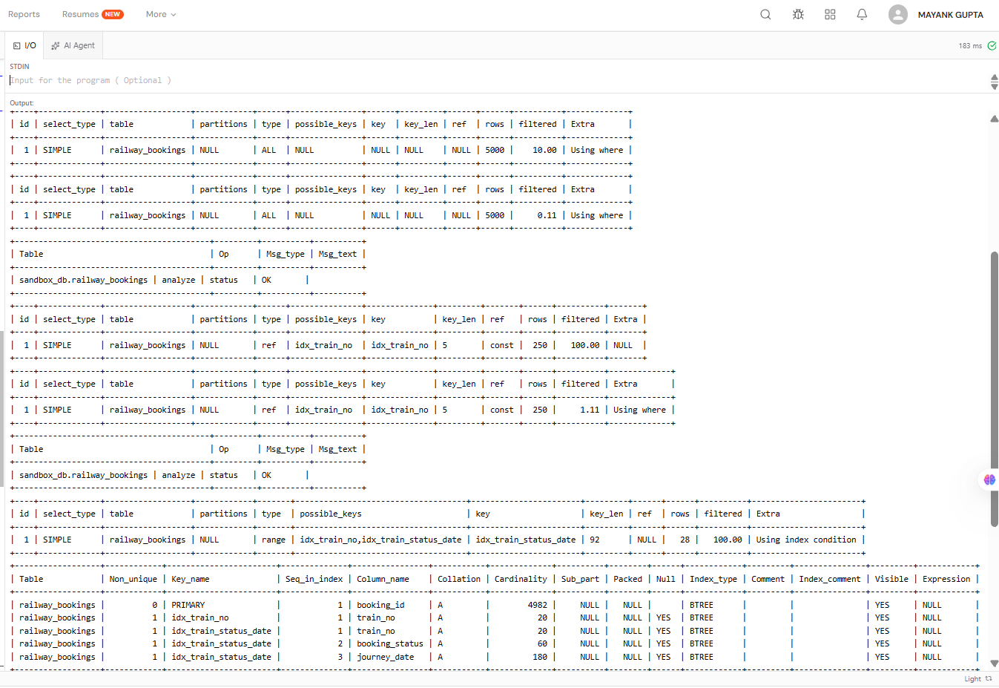

# DBMS Practical – Experiment 9

## Indexing and Query Optimization: Railway Booking System

---

## 1. Aim

Create a Railway Booking table with at least 5,000 records. Benchmark query performance before and after creating single and composite indexes. Use `EXPLAIN` to compare execution plans.

---

## 2. Database and Files

This experiment uses MySQL and the `railway_bookings` table.

- [`exp09.sql`](exp09.sql) creates the table, inserts the sample records, and runs the verification and indexing queries.
- [`images/booking_records.png`](images/booking_records.png) shows the generated row count and sample booking records.
- [`images/index_performance.png`](images/index_performance.png) shows the execution plans before and after indexing, along with the final index list.

**Note:** The SQL script drops and recreates `railway_bookings`. Do not run it if you need to preserve data in a table with this name.

---

## 3. Table and Sample Data

The `railway_bookings` table stores:

| Column | Description |
|---|---|
| `booking_id` | Unique booking identifier and primary key |
| `passenger_name` | Passenger name |
| `train_no` | Train number |
| `source_station` | Journey origin |
| `destination_station` | Journey destination |
| `journey_date` | Date of travel |
| `coach_type` | Coach class |
| `booking_status` | Booking state |
| `fare` | Ticket fare |

The script generates 5,000 deterministic sample rows with varied train numbers, routes, journey dates, coach types, booking statuses, and fares.

---

## 4. Queries Analyzed

### Query 1: Search by Train Number

```sql
SELECT *
FROM railway_bookings
WHERE train_no = 12005;
```

### Query 2: Search by Train, Status, and Date Range

```sql
SELECT *
FROM railway_bookings
WHERE train_no = 12005
  AND booking_status = 'CONFIRMED'
  AND journey_date BETWEEN '2026-02-01' AND '2026-03-31';
```

`EXPLAIN` is run for both queries before and after creating indexes. The sample screenshot shows that before indexing both queries use a full table scan (`type = ALL`, estimated `rows = 5000`). After adding the `train_no` index, Query 1 uses `idx_train_no` (`type = ref`, estimated `rows = 250`); the multi-condition query can still use that index but must filter additional rows.

`EXPLAIN` reports the optimizer's plan and estimated row counts; it does not report elapsed query execution time. This experiment's supplied output compares plans and index access. Actual elapsed times depend on the database server, cache state, and client.

---

## 5. Indexes Created

### Single-Column Index

```sql
CREATE INDEX idx_train_no
ON railway_bookings(train_no);
```

This index speeds up searches by train number and can also serve as the leading index for the multi-condition query.

### Composite Index

```sql
CREATE INDEX idx_train_status_date
ON railway_bookings (train_no, booking_status, journey_date);
```

The composite index follows the multi-condition query's equality predicates (`train_no` and `booking_status`) followed by the date-range predicate (`journey_date`). The screenshot shows the optimizer selecting `idx_train_status_date` for this query, with an estimated 28 rows and `Using index condition`.

The index column order matters: a composite index is most useful when query predicates use its leading columns. After creating each index, the script runs `ANALYZE TABLE` so MySQL can refresh index statistics.

---

## 6. Output Screenshots

### Booking Record Verification

The output confirms that 5,000 rows were inserted and displays the first 10 booking records.



**Output Screenshot – Booking Records**

### Query Plan and Index Comparison

The output compares the execution plans before indexing, after the single-column index, and after the composite index. It also shows the indexes defined on the table.



**Output Screenshot – Index Performance**

---

## 7. How to Run

1. Open a MySQL client and select the schema for this practical.
2. Run `exp09.sql` from top to bottom.
3. Check that `total_records` is `5000` and review the sample rows.
4. Compare the `EXPLAIN` output before indexing, after the single-column index, and after the composite index.
5. Run `SHOW INDEX FROM railway_bookings;` to inspect the primary key and created indexes.

The exact row estimates and optimizer choices can vary by MySQL version and table statistics. Use the `EXPLAIN` output from your own run as the final plan for your database.

---

## 8. Result

The experiment creates and verifies 5,000 railway bookings and demonstrates how a single-column index and a composite index can change MySQL's query execution plan from a full table scan to index-based access for suitable predicates.
