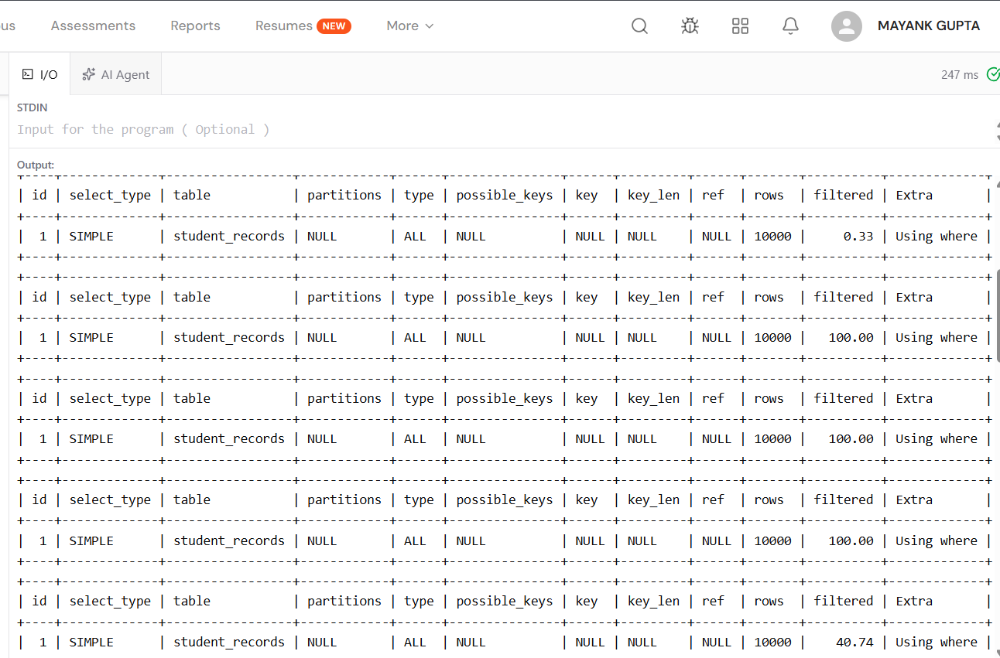
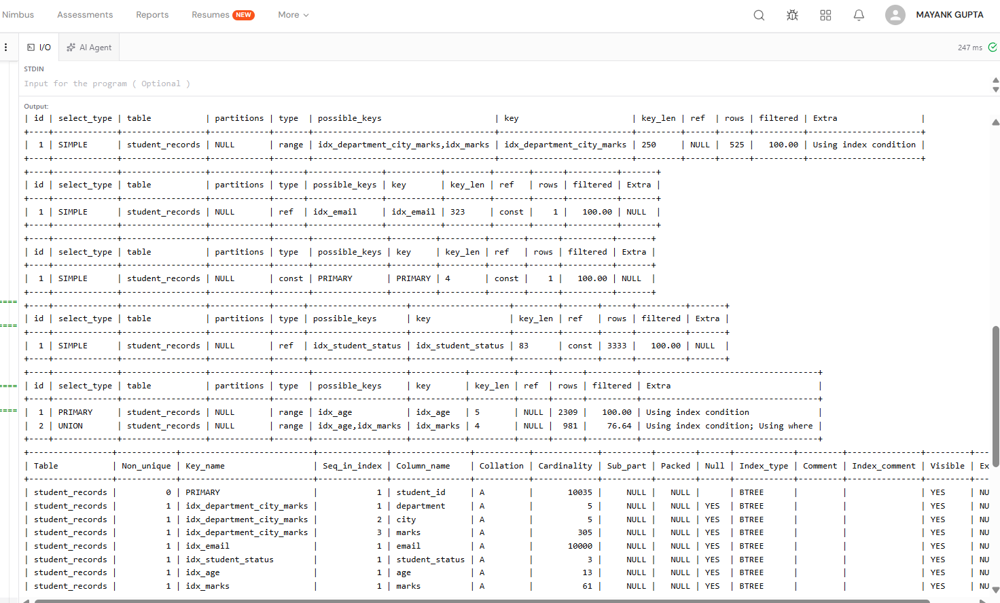
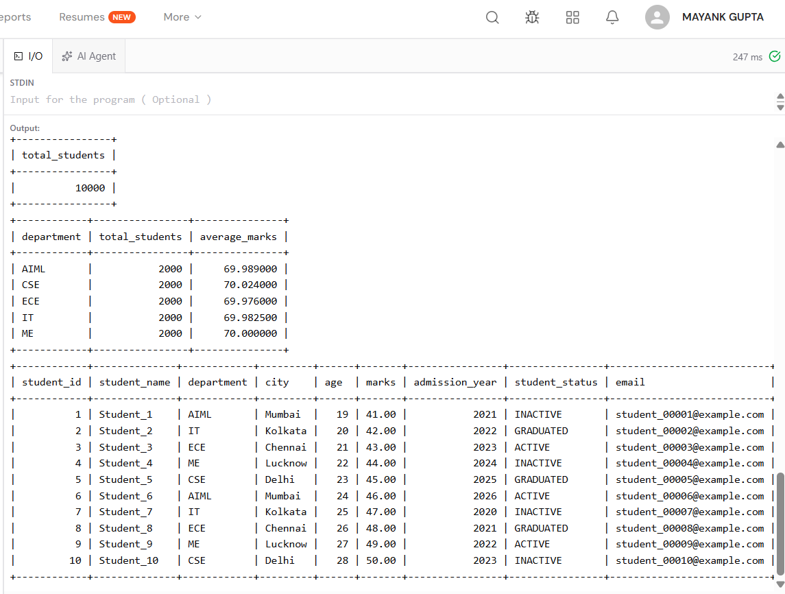

# DBMS Practical – Experiment 10

## Query Optimization: Student Records Dataset

---

## 1. Aim

Generate a dataset with at least 10,000 rows. Write five slow queries, analyze using `EXPLAIN`, optimize using indexing and query rewriting, and compare execution time before and after optimization.

---

## 2. Database and Files

This experiment uses MySQL and the `student_records` table.

- [`exp10.sql`](exp10.sql) creates the table, inserts the generated dataset, runs five initial `EXPLAIN` queries, creates indexes, runs optimized queries, checks the indexes, and verifies the final data.
- [`images/query_before_optimization.png`](images/query_before_optimization.png) shows the initial query plans.
- [`images/query_after_optimization.png`](images/query_after_optimization.png) shows the plans after indexing and query rewriting, plus the index list.
- [`images/final_dataset_verification.png`](images/final_dataset_verification.png) verifies the 10,000 students, department totals, averages, and sample rows.

**Note:** The script drops and recreates `student_records`. Do not run it if you need to preserve data in a table with this name.

---

## 3. Dataset

The script generates exactly 10,000 student rows with the following fields:

| Column | Description |
|---|---|
| `student_id` | Student identifier and primary key |
| `student_name` | Generated student name |
| `department` | Department |
| `city` | City |
| `age` | Student age |
| `marks` | Student marks |
| `admission_year` | Admission year |
| `student_status` | Student status |
| `email` | Generated email address |

Five departments are generated with 2,000 rows each.

---

## 4. Five Queries Before Optimization

The initial queries use functions on indexed/search columns, combine predicates, or use an `OR` condition. These forms can prevent efficient index access or require scanning many records.

### Query 1: Department, City, and Marks

```sql
SELECT *
FROM student_records
WHERE department = 'CSE'
  AND city = 'Delhi'
  AND marks >= 85;
```

### Query 2: Function on Email

```sql
SELECT *
FROM student_records
WHERE LOWER(email) = 'student_05000@example.com';
```

Applying `LOWER()` to the column makes the indexed lookup less direct.

### Query 3: Calculation on the Primary Key

```sql
SELECT *
FROM student_records
WHERE student_id + 0 = 5000;
```

The expression on `student_id` prevents a straightforward primary-key lookup.

### Query 4: Function on Student Status

```sql
SELECT *
FROM student_records
WHERE UPPER(student_status) = 'ACTIVE';
```

Applying `UPPER()` to the column can prevent direct use of a normal index on `student_status`.

### Query 5: `OR` Across Age and Marks

```sql
SELECT *
FROM student_records
WHERE age BETWEEN 20 AND 22
   OR marks >= 95;
```

The optimizer must account for two different search conditions.

---

## 5. Indexes and Rewritten Queries

The SQL script creates these indexes:

| Index | Columns | Used for |
|---|---|---|
| `idx_department_city_marks` | `department`, `city`, `marks` | Query 1's equality predicates followed by the marks range |
| `idx_email` | `email` | Direct email lookup |
| `idx_student_status` | `student_status` | Direct status lookup |
| `idx_age` | `age` | Age range in Query 5 |
| `idx_marks` | `marks` | Marks range in Query 5 |

### Optimized Query 1

The predicates stay the same; the composite index supports them in left-to-right order:

```sql
SELECT *
FROM student_records
WHERE department = 'CSE'
  AND city = 'Delhi'
  AND marks >= 85;
```

### Optimized Query 2

Compare the stored email directly rather than applying a function:

```sql
SELECT *
FROM student_records
WHERE email = 'student_05000@example.com';
```

### Optimized Query 3

Compare the primary-key value directly:

```sql
SELECT *
FROM student_records
WHERE student_id = 5000;
```

### Optimized Query 4

Compare the stored status directly:

```sql
SELECT *
FROM student_records
WHERE student_status = 'ACTIVE';
```

### Optimized Query 5

Use `UNION ALL` to let MySQL consider the age and marks indexes separately. The second branch excludes rows already returned by the first branch, so each matching record appears once:

```sql
SELECT *
FROM student_records
WHERE age BETWEEN 20 AND 22

UNION ALL

SELECT *
FROM student_records
WHERE marks >= 95
  AND age NOT BETWEEN 20 AND 22;
```

This rewrite is equivalent for this generated dataset, whose `age` and `marks` values are non-`NULL`.

---

## 6. EXPLAIN Results

The before-optimization screenshot shows all five original queries scanning the table (`type = ALL`, estimated `rows = 10000`).

The after-optimization screenshot shows the optimizer using indexes:

- Query 1 uses `idx_department_city_marks` with range access.
- Query 2 uses `idx_email` and estimates one matching row.
- Query 3 uses the `PRIMARY` key and estimates one matching row.
- Query 4 uses `idx_student_status`; because there are many active records, it still examines an estimated 3,333 rows.
- Query 5 uses range access through `idx_age` and `idx_marks` in the two `UNION ALL` branches.

The exact access paths and estimated row counts may vary by MySQL version and table statistics. `ANALYZE TABLE student_records;` refreshes index statistics before reading the plans.

---

## 7. Execution-Time Comparison

The supplied SQL uses `EXPLAIN`, which reports optimizer estimates and access paths, not actual query elapsed time. The screenshots show query plans; the `247 ms` shown by the SQL runner is the overall script run time, not a separate before/after measurement for each query. Do not use it as a per-query benchmark.

To collect actual execution times in MySQL 8.0, use `EXPLAIN ANALYZE` on each original query before creating indexes, then run `EXPLAIN ANALYZE` on its optimized version after creating the indexes and running `ANALYZE TABLE`. For example:

```sql
-- Before optimization: run before creating indexes
EXPLAIN ANALYZE
SELECT *
FROM student_records
WHERE department = 'CSE'
  AND city = 'Delhi'
  AND marks >= 85;

-- After optimization: run after creating indexes
EXPLAIN ANALYZE
SELECT *
FROM student_records
WHERE department = 'CSE'
  AND city = 'Delhi'
  AND marks >= 85;
```

Repeat this for all five query pairs, substituting the original and rewritten SQL shown above. Record the `actual time` and `actual rows` values from each plan in your own MySQL environment. Runtime measurements can differ due to caching, server hardware, and concurrent load; `EXPLAIN ANALYZE` executes the `SELECT` as it measures it.

---

## 8. Output Screenshots

### Before Optimization



**Output Screenshot – Before Optimization**

### After Optimization



**Output Screenshot – After Optimization**

### Final Dataset Verification



**Output Screenshot – Dataset Verification**

---

## 9. How to Run

1. Open a MySQL client and select the schema for this practical.
2. Run `exp10.sql` from top to bottom.
3. Confirm that `total_records` and `total_students` are both `10000`.
4. Compare the initial and optimized `EXPLAIN` plans.
5. To measure query runtimes, run the matching `EXPLAIN ANALYZE` pairs as described in section 7, capturing each original query before creating indexes and each optimized query afterward.

---

## 10. Result

The experiment creates a 10,000-row student dataset, analyzes five original queries, and demonstrates improvements from composite/single-column indexes and sargable query rewrites. `EXPLAIN` verifies plan changes; actual before/after timings should be measured with `EXPLAIN ANALYZE` on the local MySQL server.
